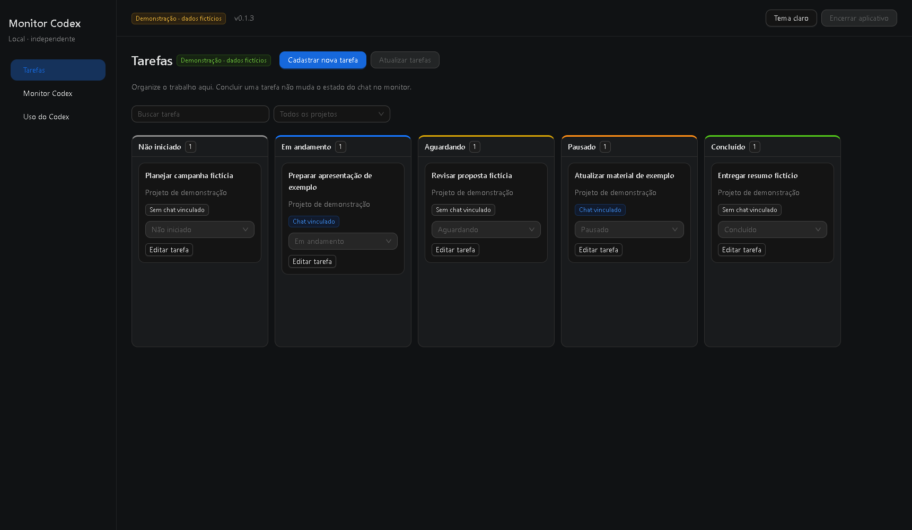
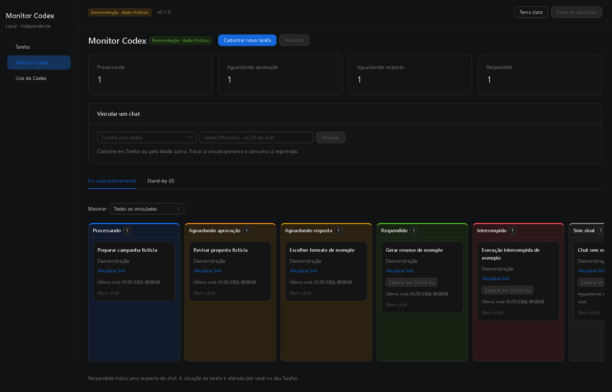
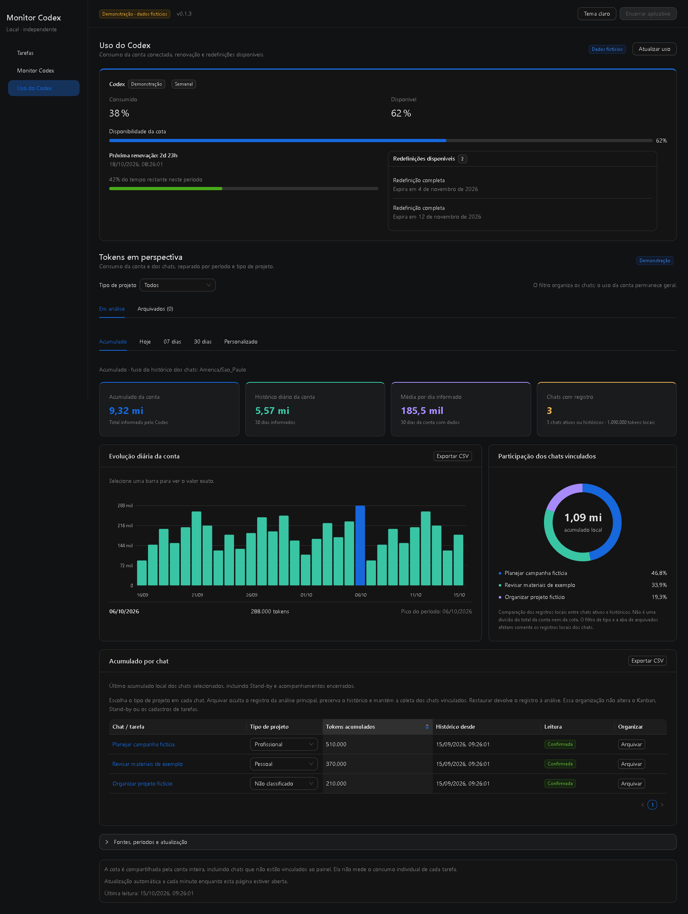

# Monitor Codex Local

Organize tarefas e acompanhe seus chats do Codex em um painel local no navegador.

**Windows · Node.js 24+ · MIT · versão 0.1.4**

O aplicativo reúne **Tarefas → Monitor Codex → Uso do Codex**. Tem interface e banco próprios, sem NocoBase, Docker ou extensão de navegador. É um projeto independente, sem vínculo oficial com OpenAI ou NocoBase.

## O que você pode fazer

- **Organizar tarefas:** cadastrar e editar num painel lateral, buscar, filtrar por projeto e mudar a situação no Kanban.
- **Acompanhar chats:** Processando, Aguardando aprovação, Aguardando resposta, Respondido, Interrompido, Sem sinal e Estado não confirmado. Usar Stand-by e trocar/remover o link.
- **Consultar uso:** cota da conta, próxima renovação, validade das redefinições e tokens da conta e dos chats vinculados, quando disponíveis nas fontes locais do Codex.
- **Separar a análise:** Acumulado, Hoje, 07 dias, 30 dias e Personalizado; tipos Pessoal/Profissional, arquivamento da análise e exportação CSV.
- **Preservar o histórico:** remover o vínculo para de acompanhar o chat quando nenhum outro cadastro o usa, mantendo o consumo já registrado.
- **Escolher o tema:** claro ou escuro, com layout adaptado a telas menores.

Concluir uma tarefa não conclui o chat. A situação da tarefa é sua; o estado do chat vem dos eventos e das confirmações do Codex.

## Veja as três abas do painel

Capturas do aplicativo real em modo de demonstração e tema escuro. Todos os nomes, números, datas e vínculos são fictícios. Clique em uma imagem para ampliá-la.

### Tarefas

Cadastre e edite tarefas pelo painel lateral, encontre-as pela busca ou pelo projeto e organize a situação do trabalho no Kanban. A tarefa continua acessível mesmo sem chat vinculado.



### Monitor Codex

Acompanhe os estados dos chats, veja os contadores, vincule tarefas e acesse o Stand-by.



### Uso do Codex

Consulte cota, próxima renovação e validade das redefinições. Analise tokens pelas abas de período, filtre projetos pessoais/profissionais, consulte registros arquivados e exporte CSV. O consumo geral da conta aparece separado dos registros locais dos chats.



Para explorar sem gravar dados, abra `http://127.0.0.1:13021/?demo=1#tarefas` depois de iniciar o aplicativo. A demonstração não consulta as APIs de tarefas, estados ou consumo.

## Instalação: escolha um caminho

O uso foi validado no **Windows com Node.js 24**. Tenha o Codex instalado e conectado à sua conta para acompanhar chats reais. Esta versão ainda não tem instalador `.exe`; a integração completa em macOS/Linux não foi certificada.

Baixe o ZIP pronto em **Releases** deste repositório e extraia em uma pasta permanente. Se preferir, use **Code → Download ZIP**: a interface compilada também acompanha o código. **Não é preciso usar Git, npm, Docker ou criar um banco para instalar o pacote pronto.**

### Opção A — instalar com ajuda do Codex

Abra a pasta extraída como projeto no Codex e envie:

> Leia docs/INSTALAR-COM-CODEX.md e instale o Monitor Codex Local neste computador. Verifique os pré-requisitos, prepare a configuração, oriente as intervenções humanas e teste cadastro, atualização automática e encerramento. Preserve outras instalações e não configure início automático com Windows.

O [roteiro de instalação assistida](docs/INSTALAR-COM-CODEX.md) orienta o agente a verificar Node, arquivos, porta e permissões, configurar os eventos autorizados e testar o resultado. A revisão de confiança dos hooks continua sendo sua. **Se escolher esta opção, não precisa repetir o procedimento manual abaixo.**

### Opção B — instalar manualmente

1. Instale [Node.js 24 ou superior](https://nodejs.org/en/download), se faltar.
2. Na pasta extraída, abra **Configurar-Codex.cmd**, confira o destino, digite **S** e pressione Enter. Aguarde **INSTALAÇÃO CONFIRMADA: 9/9 eventos**.
3. Revise e autorize os novos hooks no Codex. Se necessário, feche e abra o Codex para recarregar a configuração.
4. Abra **Abrir-Monitor.cmd**. O navegador abrirá o painel em `http://127.0.0.1:13021`.

O [guia manual](docs/INSTALACAO-MANUAL.md) explica cada etapa, a revisão dos hooks, portas e diagnóstico. O configurador testa o comando no CMD e no PowerShell antes de gravar, preserva os outros handlers e guarda um backup privado.

## Primeiro uso

1. Entre em **Tarefas → Cadastrar nova tarefa**.
2. Informe o nome, o projeto opcional e a situação. Salve; a tarefa pode existir sem chat.
3. Copie o link local do chat no Codex. Use `codex://threads/ID` ou apenas o ID; links públicos de compartilhamento não servem.
4. Vincule pelo campo do cadastro ou por **Monitor Codex → Vincular um chat**.
5. Retome uma atividade nesse chat. O monitor começará a receber os eventos automaticamente.

Cadastrar um link sozinho não produz um evento nem confirma o estado de um chat parado. **Coletor conectado** significa que o processo local responde; a configuração dos hooks, a confiança e o recebimento de eventos são verificados separadamente. O painel avisa quando a configuração está pendente.

Para editar ou reencontrar uma tarefa, volte à aba **Tarefas**. No monitor, **Atualizar link** permite trocar ou remover o vínculo. Stand-by guarda chats inativos e o acompanhamento retorna quando uma nova atividade é observada.

## Abrir e encerrar

### Criar um atalho na Área de Trabalho

Depois de extrair o pacote em uma **pasta permanente**, você pode criar um atalho para abrir o painel sem precisar procurar essa pasta:

1. No Explorador de Arquivos, localize **Abrir-Monitor.cmd** na pasta extraída.
2. Clique nele com o botão direito. No Windows 11, clique em **Mostrar mais opções**, se necessário.
3. Escolha **Enviar para → Área de trabalho (criar atalho)**.
4. Na Área de Trabalho, renomeie o atalho para **Monitor Codex Local**.

Dê dois cliques no atalho para iniciar o aplicativo e abrir o navegador. O atalho deve apontar para **Abrir-Monitor.cmd**, pois esse arquivo inicia o painel. Salvar apenas o endereço no navegador não inicia o processo quando ele está desligado.

Se instalou com ajuda do Codex, pode pedir: **“Crie um atalho na minha Área de Trabalho para o Abrir-Monitor.cmd desta instalação, com o nome Monitor Codex Local.”**

Mantenha a pasta completa do aplicativo. Se movê-la, recrie o atalho e reconfigure os hooks conforme o [guia manual](docs/INSTALACAO-MANUAL.md). Criar o atalho não configura início automático com o Windows.

### Comandos do aplicativo

| Ação | Como fazer |
| --- | --- |
| Abrir | Atalho **Monitor Codex Local** ou **Abrir-Monitor.cmd** |
| Encerrar | **Encerrar aplicativo** no topo, com confirmação; ou **Encerrar-Monitor.cmd** |
| Diagnosticar | **Diagnosticar-Monitor.cmd** |
| Preparar/reconfigurar eventos | **Configurar-Codex.cmd** |

**Fechar somente a aba não encerra o Node.** Ao encerrar pelo botão ou arquivo, o processo desta cópia termina e os dados permanecem salvos. O aplicativo não instala serviço nem inicia com o Windows. Abrir duas vezes reutiliza o próprio processo.

## Dados e limites

Os cadastros e o histórico ficam em **`.local/data/`**, no seu computador. O pacote público começa vazio; suas tarefas são cadastradas depois da instalação. Prompts, respostas, transcrições e credenciais não são salvos pelo monitor.

- A cota da conta é geral; filtros de projeto organizam somente os registros dos chats.
- Dados ausentes aparecem como indisponíveis ou não confirmados, sem inventar consumo zero.
- O histórico por período dos chats começa na primeira coleta. Intervalos sem coleta podem deixar lacunas.
- As fontes de uso e de confirmação dependem de capacidades compatíveis do Codex, que podem mudar.
- As redefinições são somente consultadas; o painel não oferece botão para consumir uma delas.

Veja como [atualizar e fazer backup](docs/ATUALIZACAO-E-BACKUP.md). Dados, logs e configurações locais são excluídos da distribuição por uma lista explícita de arquivos.

## Desenvolvimento

Esta seção é apenas para quem vai alterar o código. **Não faz parte da instalação do pacote pronto.**

```powershell
npm ci
npm run build
npm test
npm run check:distribution
npm run export
```

React e Ant Design compõem a interface; Node atende apenas `127.0.0.1`, e SQLite guarda as tarefas próprias. O banco do Codex é consultado somente em leitura para metadados numéricos permitidos.

Leia [AGENTS.md](AGENTS.md) antes de modificar o comportamento. A checagem de distribuição recusa arquivos privados e IDs reais, e a verificação no GitHub executa os testes em Windows com dados fictícios.

## Licença e versões

Licença [MIT](LICENSE). As dependências mantêm seus próprios avisos de licença, incluídos em `public/app.js.LEGAL.txt`. Consulte o [histórico de versões](CHANGELOG.md).

A versão para NocoBase é um projeto separado: [monitor-codex-nocobase](https://github.com/magalisantosdesign-stack/monitor-codex-nocobase).
